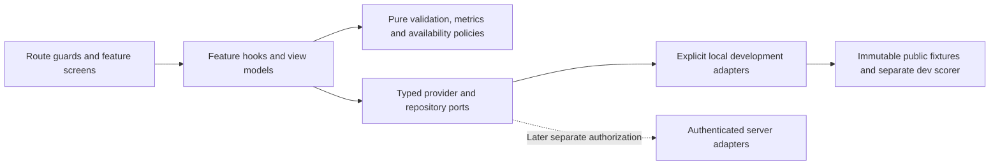

# Architecture and routes proposal

PROPOSED_DESIGN — 2026-10-23. No architecture has been implemented by this review. STAGE_2_ENTRY = BLOCKED. Decisions D01/D03/D05/D06/D07 remain open.

## Evidence-led stack choice

The current SPA already has React 18, strict TypeScript, Vite, Router, Lucide, reusable components, pure services, local persistence and six Node/assert/esbuild suites. The isolated build passes. Preserve those investments and npm's current lockfile; do not run a scaffold, upgrade React or change hosting/framework for a planning exercise.

Preferred option: incremental feature boundaries within this app. Keep HashRouter/legacy normalization initially; clean-path BrowserRouter is an optional later migration requiring deep-link, refresh and hosted fallback evidence. Alternative Next/SSR may benefit a future SEO public site but adds server/runtime/routing/state migration obligations without solving diagnostic validity. Tailwind/shadcn could provide selected primitives later; wholesale replacement would discard working CSS. No new package is necessary for Stage 1A.

## Proposed dependency direction

Ports/policies must not import rendered screens. Screens never reach directly into the question key map, browser storage or a future HTTP client. Current `services/platform.ts` mixes all of these concerns; extract it gradually behind tests after approval, rather than moving files wholesale now.

Proposed folder boundaries (all paths below are future examples): `src/app/` composition/routes/providers; `src/shared/ui/` existing evolved primitives; `src/features/auth/`, `onboarding/`, `diagnostic/`, `dashboard/`; `src/contracts/` typed public boundaries; `src/adapters/local/` and later `src/adapters/http/`; `src/fixtures/diagnostic/starter-v1.json`; `src/fixtures/scoring/starter-v1.keys.json` development-only; `src/policies/` selectors/validation/metric definitions. Existing module/exam/content files stay operational and archived references stay untouched. Do not infer these directories already exist.

## Providers and state ownership

| Boundary | Responsibility | Current reusable work / needed separation |
|---|---|---|
| SessionProvider/SessionPort | checking/anonymous/authenticated/error; explicit DEMO vs SERVER | session service subscription reusable; local boolean is not identity |
| LearnerRepository + feature hook | validated profile/onboarding, revision, save status | state defaults/migrations reusable; currently unsafely coupled multi-key writes |
| ThemeProvider | explicit light/dark/system preference and resolved palette | larger-text behavior reusable; dark provider absent |
| DiagnosticQuestionSource | public assessment, pinned attempts, drafts and submission | current fixed data reusable only after content/key review; no stable assignment today |
| DiagnosticScorer | objective raw score validity and unscored responses | current heuristics must not be accepted as bands/readiness |
| ActivityRepository | durable, deduplicated, scoped events with origin | current event/log concept reusable; nominal minutes/legacy/demo provenance insufficient |
| DashboardProvider | source-linked metric envelopes and deterministic next action | layout reusable; do not compute bands/priority from missing data |
| FeatureAvailabilityPolicy | F01–F18 state/reason/navigation | static navigation reusable; central source registry not yet present |
| Later Content/AI adapters | licensed resources; separately evaluated assistance | current structured blocks and strict mode policy preserved as prototype |

Use existing React external-store subscriptions for durable client snapshots, feature-local state for temporary UI, pure selectors for derived state and Context for provider injection. Avoid introducing Redux/Zustand by default. When real HTTP state exists, review a dedicated query/cache library then. [React's external-store contract](https://react.dev/reference/react/useSyncExternalStore) requires stable snapshots until data changes; repository subscriptions should be tested for duplicate notifications and stale reads.

## Auth, privacy and recovery

Production SessionPort must delegate credentials/session verification to an approved secure service; UI-only route guards cannot authorize records. Proposed later cookie-based web boundary needs ownership/CSRF/rate-limit/session-expiry review. Keep credentials/tokens out of localStorage, logs, URLs and metric events. Recovery forms remain explicitly preview-only until a real provider exists. No accounts were connected during this review.

Keep today's local progress and migration inputs intact. A later migration needs an explicit pre-write snapshot/export, versioned decoder, duplicate-safe transform, rollback and fixture tests for complete/partial/skipped/corrupt/unknown-version records. Preserve unverified legacy results/history without using them as validated new metrics. Isolate sample learner seeding from real learner stores; `loadDemo()` currently resets learning data and must not be repurposed as normal account login.

Every provider operation exposes pending/success/error with typed retry semantics. Guard while session loads; never flash a score before eligibility validation. Failed saves leave editable content visible and prevent false advancement. Concurrent draft revision conflict retains both evidence and a recovery choice; retry is idempotent. Unknown resources/versions return safe links; no fallback to silently changed questions or fake data. Core dashboard remains accessible when diagnostic is skipped/unavailable.

## Routes, components and future availability

The complete observed route/alias table and proposed guards live in [routes and states](../../ROUTES_AND_STATES.md). Stage 1B proposal changes only existing core screens and optional attempt-scoped URLs if approved. Stage 2 may add labeled navigation destinations for TED/AWL/grammar/resources/curriculum/notes; F17/F18 stay conditional. Existing strict Exam route locking must remain isolated from diagnostic participation and needs an explicit policy decision before broadening changes.

Reuse Button/Card/PageHeader/ProgressBar/EmptyState, fields and choice groups, AppShell, ContentViewer/ActivityRenderer and native dialog patterns. Proposed MetricCard accepts a MetricEnvelope rather than arbitrary numeric props; AvailabilityBadge reflects actual evidence; reusable FormField/ErrorSummary associates each error with its input. Retain strict no-AI policy in existing Test/Exam, but do not claim client-side hidden content is secret or tamper-proof.

Design evolution and semantic token proposals are in [UI design system](../../UI_DESIGN_SYSTEM.md). Light/dark, keyboard and compact-screen behavior must be verified together. Public copy and availability cannot advertise future AI/content/payments as live. Candidate palettes are not accepted visual requirements.

## Integration and test boundary

Draft public API shapes are in [data contracts](../../DATA_CONTRACTS.md) and [diagnostic proposal](DIAGNOSTIC_DYNAMIC_SOURCE_CONTRACT_PROPOSAL.md). No backend endpoints or SDKs exist. Use an explicit composition choice for development fixture versus server mode; production builds must not accidentally activate illustrative seeds or local secret-key scoring. Secure assessment marking and authenticated multi-device storage cannot be accomplished merely by replacing a URL string.

Future tests: pure version/key/metric/state rules using existing service test pattern; provider contract fixtures and revision/retry integration; rendered skip/resume/submit/no-score/error flows; both themes, keyboard/focus/reflow; route and alias regressions. Existing suites are valuable but several assert now-unaccepted heuristic scoring. Preserve them as historical behavior tests until a separately authorized change deliberately replaces the assertions with the accepted contract. The [acceptance plan](DASHBOARD_ACCEPTANCE_TEST_PLAN.md) lists explicit expected outputs.
